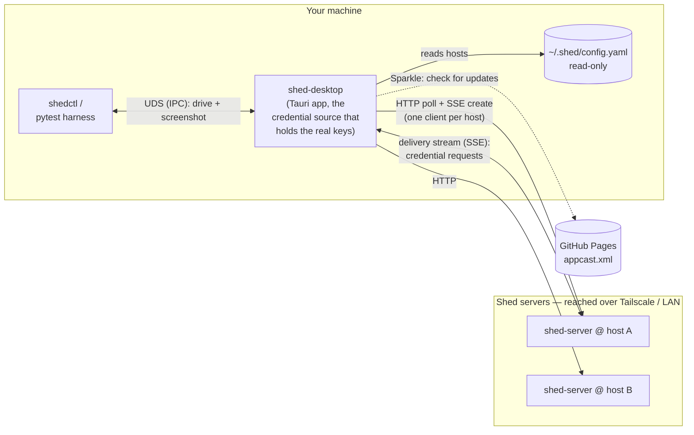

# Architecture

shed-desktop is a desktop app that ties the **shed** toolchain into one resident control
surface: it lists and controls sheds (VMs) across hosts, shows the agent sessions running in
them as [roost](../extensions/roost-session-hosts.md) rows with live
[craze lanes](agent-lanes.md), and is the user's **credential source**: it answers a server's
delivery request with the files and variables the user configured — see [The credential
source for delivery](#the-credential-source-for-delivery). The app is the only credential
source; there is no separate daemon, and there are no approval prompts.
There is no remote-control (RC) launcher: the RC stack was retired, and agents start through
roost or craze.

The app is a **Tauri** client on both macOS and Linux, built from `desktop/tauri/src-tauri`
(bin `shed-desktop-tauri`). All protocol and app logic lives in the shared **Rust core**:
`shed-core` (the shed-server protocol layer — HTTP/SSE, decoding, control-token auth, TLS
pinning), **`shed-app`** (the UI-free shed client), **`shed-desktop-core`** (the shed-only
hosts, craze and lane runtime), `shed-lane`, `shed-roost` and `shed-craze` — see
[Rust core](rust-core.md). On Linux it ships
as the `shed-desktop` nfpm `.deb` (`/usr/bin/shed-desktop`, with a headless `shedctl`
alongside) via `charliek/apt-charliek` (`apt install shed-desktop`); on macOS as
the notarized DMG with Sparkle updates. A first-class design goal is that the app is
**drivable and observable by an automated agent** over an IPC socket — see [IPC](ipc.md).

## System context

shed-desktop sits between two other systems: the **shed servers** (one per host, over
HTTP, plus a delivery stream for credential requests) and the **shed CLI's config file**
(read-only: `servers:` and `default_server`). Its credential source runs inside the
app. It also serves its own control socket that
`shedctl` and the test harness drive, and checks GitHub Pages for Sparkle updates.

The app is in the credential path only at delivery time. When a shed is created, or
`shed provision` runs, the shed's server asks its user's bound machine for the credentials
the shed should hold; the app answers with what its providers read from disk, and the
server writes it into the shed. Nothing is asked per use afterwards, and no prompt is shown.
See [The credential source for delivery](#the-credential-source-for-delivery).

## Structure

| Part | Where | Role |
|---|---|---|
| Rust shell | `desktop/tauri/src-tauri/src/` | The Tauri app: `lib.rs` (setup, the Tauri commands the UI invokes), `ipc.rs` (the control socket and its op dispatch), `delivery.rs` and `source.rs` (the delivery runtime's and the credential-source IPC ops' adapters), `egress.rs` (the egress feed), `tray.rs` (tray menu + macOS popover), `updater.rs` (Sparkle, macOS), thin adapters over `shed-desktop-core` (`ShedHosts`, `ShedCraze`, `ShedLanes`), `termctl.rs` (terminal launch), `prefs.rs` (persisted preferences), `screenshot.rs`, `single_instance.rs`, `shutdown.rs`, `applog.rs` |
| Web UI | `desktop/tauri/ui/` | React + Vite + TypeScript: the dashboard (`App.tsx`, including the Credentials view), the Preferences window (General and Terminal), the macOS tray popover, and the agent-lane panels. It reports what it rendered back to the shell, which is what the IPC `*.dump` ops answer from |
| Shared core | `crates/` | `shed-lane` (lane contract, RC DTOs, slash menu), `shed-core` (protocol, config), `shed-roost` (roost client; the only `roost-ipc` crate), `shed-app` (`Backend`), `shed-desktop-core` (shed-only hosts, craze and lanes, the delivery runtime, the egress feed), `shed-source` (machine identity, certificate store, control-token minting and the delivery stream client), `shed-provision` and `shed-provision-providers` (the delivery contract and the five providers), `shed-craze` (the lane adapter) — see [Rust core](rust-core.md) |
| `shedctl` | `crates/shedctl/` | A headless CLI for the control socket — see [shedctl](cli.md) |
| Bundled openers | `desktop/Resources/bin/` | `shed-open-ghostty` and `shed-open-roost.py`, the terminal presets' launch scripts, shipped as app resources |

The Tauri crate is its own cargo workspace (so its WebKitGTK/Tauri dependencies stay out of
`crates/`) and takes `shed-core`, `shed-app`, `shed-desktop-core`, `shed-source`, `shed-lane`, `shed-roost`
and `shed-craze` as path dependencies. It does not depend on `roost-ipc` directly.

## How the pieces connect

### Shed servers (HTTP)

`shed-app`'s `Backend` builds one `shed-core` client per host from the config and fans out to
all of them concurrently. Unreachable hosts degrade to a grey dot, never a hard failure of the
whole list.

| Call | Endpoint | Notes |
|---|---|---|
| Server info | `GET /api/info` | name, version, ports, backend |
| List sheds | `GET /api/sheds` | tolerates `{"sheds": null}` → `[]`; stamps the host name |
| Disk usage | `GET /api/system/df` | the **System** pane (per-host totals + entries) |
| Lifecycle | `POST /api/sheds/{name}/start\|stop\|reset`, `DELETE /api/sheds/{name}` | |
| Create | `POST /api/sheds` with `Accept: text/event-stream` | **SSE** stream: `progress…` → `complete` / `error` |
| Credential sources | `GET /api/sources`, `POST /api/sources/use` | the Credentials view's **Answer from here**; `POST /api/sources/unbind` for **Stop answering from here**; a plain `404` means the server predates them (see [Machine identity and the credential source](#machine-identity-and-the-credential-source)) |
| Activity | `GET /api/activity` | the **Activity** pane: every configured server's events, merged newest first |
| Egress | `GET /api/egress/stream`, the egress profile routes | a shed's recent blocks in its detail; the profiles listed in **System** |

Shed lifecycle has **no push event stream**, so the dashboard **polls** `GET /api/sheds`
on an interval. SSE is used *only* for create-progress (which the server does stream).

Every call to a server reached over `https` presents a control-scope credential: on an `mtls`
server a client certificate whose private key is generated in the app and never leaves it,
obtained over the server's `_bootstrap` SSH channel by `shed-source` and kept in
memory only (a server older than 0.10.0 still in token mode, removed in 0.10.0, gets a bearer token the same way). An
`open` server is reached over plain `http`, listens on loopback only, and takes no credential.
The app never exposes a server further.

### The credential source for delivery

The app runs one delivery stream per configured server (`shed-source`, built on the machine identity and certificate store, which keep their paths from earlier releases). The server asks the stream's machine, the user's bound one, for a shed's credentials; the app answers with `shed-provision` and the five providers from `delivery.toml`, re-read for each request. The answer is built and sent with no prompt. The app starts with the stream and stops with it: quitting the app stops delivery, so credentials are delivered only while the app is running. The app turns on launch at login the first time it starts (see [Installation](installation.md#credential-source)). See [Credentials](credentials.md) and [Credential delivery](../reference/delivery.md).

- **Multi-server:** one app holds a stream per server; requests carry the server so identical shed names on different servers do not collide, and the `only.servers` rule is judged against the server a request came in on.
- **No approvals:** earlier releases embedded a credential broker and an approval gate (Touch ID, a Linux polkit prompt, an Approvals pane). They are gone: a delivered credential is inside the shed while it runs, usable by anything there. See [Credentials in a shed](../guides/credentials-in-a-shed.md#the-trade).
- **Observability:** the source serves no socket of its own. `delivery.status` and `source.status` (IPC) carry each stream's state (`connecting`, `connected`, `not_bound`, `duplicate`, `offline`, `stopped`), this machine's identity, and the last answers, redacted.

### Machine identity and the credential source

A shed server asks each user's sheds' questions of one machine, the
[credential source](../extensions/source-binding.md), and tells machines apart by an id the
app sends on every stream and answer. The app keeps this machine's identity in
`machine.json` (`~/Library/Application Support/shed/broker/` on macOS,
`$XDG_DATA_HOME/shed/broker/` else `~/.local/share/shed/broker/` on Linux; `SHED_BROKER_STATE_DIR` replaces the `shed` directory; the directory name is kept from earlier releases so an existing identity is used as it is).

The app loads the identity when it starts. An identity it cannot load does not stop it: it
runs without one (a server with credential sources then refuses it) and
`source.status.this_machine_error` says why.

The sidebar's Credentials view shows this machine's name and, per server, who answers and an
**Answer from here** or **Stop answering from here** button (see [Configuration → Credential sources](configuration.md#credential-sources)).
The button calls `POST /api/sources/use` with this machine's own id over the app's ordinary
control-scope client, then reopens the delivery stream so it connects at once. The same
calls are the IPC ops `sources.list`, `source.use` and `source.unbind`.

### The shed CLI config

shed-desktop reads the **same config the `shed` CLI manages** — `~/.shed/config.yaml`
— to discover hosts. It parses it with `shed-core`'s tiny indentation reader (`ShedConfig`,
no YAML dependency), reading `servers:` (name → `host`, `http_port`, `ssh_port`, and the
secure-server fields) and `default_server`. It does not read or write a `machines:` block.
The CLI keeps any `machines:` block it finds and preserves it as an opaque YAML subtree on save (formatting and indentation may be normalized on re-encode). To add or remove
hosts, use the `shed` CLI; the app reflects the change on its next poll . A missing config degrades to an empty host list, never
a crash.

### The control socket (shedctl + the harness)

So the app is drivable/observable by an automated agent, `ipc.rs` serves a newline-JSON
socket at `$XDG_RUNTIME_DIR/shed-tauri.sock` (falling back to
`/tmp/shed-tauri-<uid>/shed-tauri.sock`; mode `0600`, with a sibling `shed-tauri.lock` for
single-instance — a second launch hands off to the running app with an `app.activate` op).
Both `shedctl` and the hermetic pytest harness (`desktop/tools/shedtest`) speak this exact
protocol — listing state, navigating panes, driving lifecycle, reading what the UI
rendered, and capturing PNG screenshots. This is the seam that lets every change be verified
by driving the real app, not by asking a human to click. See [IPC](ipc.md) and
[shedctl](cli.md).

## Windows + tray

The dashboard, the Preferences window and (on macOS) the tray popover are Tauri webview
windows over the one React UI. Both platforms get a native tray menu (Open Dashboard,
Preferences, Quit). On macOS a left-click on the menu-bar icon opens the popover
and a right-click the menu; on Linux the menu is the whole tray surface, because Tauri emits
no tray-click events there. On macOS the app is an accessory (`LSUIElement`): no Dock icon
until a dashboard or Preferences window is open. Building the tray is best-effort — a headless
or no-StatusNotifier Linux session has nowhere to show it — and the dashboard window is always
reachable.

## Shutting down

The app ends every child process it owns from every way it can exit: the tray's or
the popover's Quit, SIGTERM, SIGINT and SIGHUP, and on macOS a Dock Quit, a logout or an
AppleScript `quit` (which reach the app only as Tauri's `RunEvent::Exit`). All of them run
one bounded, orderly shutdown, once — a later trigger waits for the run already going. Two
things deliberately cut it short: a **second** SIGTERM/SIGINT/SIGHUP, or the 20-second escape
timeout, exits the process at once, so a wedged shutdown can never hang a quit; children the
run had not reached by then are left to their own protocols (an ssh master's
`ControlPersist`, a bridge's stdin closing).

- **Nothing new starts once it begins.** The app holds one spawn gate, closed first. Every
  place the app starts a child — a craze bridge over ssh, an ssh exec, a roost tunnel — takes a section of that gate across the spawn and the
  child's registration, so a spawn either finished before the close (and the shutdown ends
  it) or is refused with `shutting_down`; a spawn already under way when the close began
  that lands after it kills its own child at registration. The UI's own calls (a refresh,
  `lane.open`, `craze.create`, a bootstrap) are refused the same way.
- **Then it ends what it owns, in a fixed order, each step bounded:** the app's own roost
  watchers, probes and in-flight one-shots (a launch, a bootstrap, a tab close) are joined,
  and cancelled past a short bound (they are the only clients of a roost tunnel, so no
  connection can arrive while the tunnels close); the craze lanes are
  closed; the craze sources stop and every registered bridge child is killed and its exit seen, even one a
  transcript request is still holding; each roost tunnel runs its own teardown; and each ssh
  connection master is asked to exit — and, if it does not, is ended by its pid after
  checking that pid is the master on this app's control socket.
- **What the app does not own keeps running.** A craze hub and its sessions, and a remote
  `roost-session`, are left alone: a session started from the app is still there, and still
  attachable, after the app quits.

The worst case is about 16 seconds and the usual case is well under 3. Each step's time is
logged to stderr and to the app's log file (`shed-desktop-tauri: shutdown: phase N …`; the
file's location is under State + storage below), with anything it gave up on at its bound: work that could not finish in time is abandoned with the spawn gate still closed, so
nothing it starts later survives its registration. A second signal, or a
shutdown still running 20 seconds after the first signal, exits at once (status 128 + the
signal number). A crash or a `kill -9` runs none of this; an ssh master left behind then
exits on its own once its 60-second `ControlPersist` lapses.

## State + storage

| What | Where | Notes |
|---|---|---|
| Preferences | `prefs.json` in the app config dir: macOS `~/Library/Application Support/ai.stridelabs.ShedDesktop/`, Linux `${XDG_CONFIG_HOME:-~/.config}/ai.stridelabs.shed-desktop/` | terminal preset + template, and whether the launch-at-login default was applied. See [Configuration](configuration.md). |
| Delivery settings | `delivery.toml` in `~/.config/shed/` | the five providers and their `only` rules; read again for every request. See [Credentials](credentials.md). |
| Control socket + lock | `$XDG_RUNTIME_DIR/shed-tauri.{sock,lock}`, else `/tmp/shed-tauri-<uid>/` | `SHED_TAURI_SOCKET` moves the socket; the lock sits beside it. |
| Paused servers | `broker/paused-servers.json` beside `machine.json` (`0600`) | the servers this machine was told to stop answering on; an unreadable file pauses every server. See [Credentials](credentials.md#where). |
| Machine identity | `broker/machine.json` in the state directory: macOS `~/Library/Application Support/shed/`, Linux `$XDG_DATA_HOME/shed/` else `~/.local/share/shed/` | Created on first use. `SHED_BROKER_STATE_DIR` moves the directory. See [Credential Source](../extensions/source-binding.md#machine-identity). |
| Client certificates | `broker/creds/credentials/<server>/` in the same directory | The app's client certificate and key per server (`0600`). |
| Log | macOS `~/Library/Logs/ShedDesktop/shed-desktop.log`; Linux `${XDG_STATE_HOME:-~/.local/state}/ai.stridelabs.shed-desktop/shed-desktop.log` | The Tauri app's own lines and the shed crates' `tracing` events (INFO and up, including the delivery streams' connects, drops and refusals such as `not_bound` and `duplicate`, each naming its `server=`), every line stamped `<RFC 3339 UTC> <LEVEL>` and also written to stderr. `SHED_TAURI_LOG=debug` raises the shed crates to DEBUG and adds roost-ipc's events, which are off without it. Rotates at 5 MiB, keeping `.log.1`–`.log.3`. The file is private (`0600`, under your own directories; those the app creates are `0700`) and holds host names, paths and diagnostic text; `SHED_TAURI_LOG=debug` adds roost's ssh diagnostics, which can include ssh's own stderr. `SHED_TAURI_LOG_FILE` overrides the path, which must name a regular file: a symlink there is refused, never followed, as is a FIFO or a device. `identify.log_path` reports the file in use (`null` when file logging is off — a destination that cannot be opened, or a failed write, falls back to stderr only, said once). Opened only once the single-instance lock is held, so a second launch that raises the running app never writes it; a launch whose lock check fails carries on with stderr only. A dev build run beside the installed app (a different `SHED_TAURI_SOCKET`) shares this default path; set `SHED_TAURI_LOG_FILE` to keep them apart. |

There is no local audit log: the Activity pane reads each server's own `GET /api/activity`.

## Security model

The app's process reads the SSH key, `gh` sign-in, API key files and envsecrets config that
the providers you turned on name, and keeps its client certificate under its state directory.
The UI and the IPC socket see only names, targets, sizes and fingerprints, never a delivered
value.

A delivery answer is built without a prompt for any configured server that asks, so the
`only.servers` rule of each provider is the control that matters (see [Credentials](credentials.md#the-only-rules)). The app adds no remote attack surface: it makes outbound HTTP/UDS connections and serves one local
`0600` socket. Sparkle auto-update authenticity rests on an **EdDSA
signature** over each release, independent of Apple notarization (see
[RELEASING](https://github.com/charliek/shed/blob/main/desktop/RELEASING.md)).
