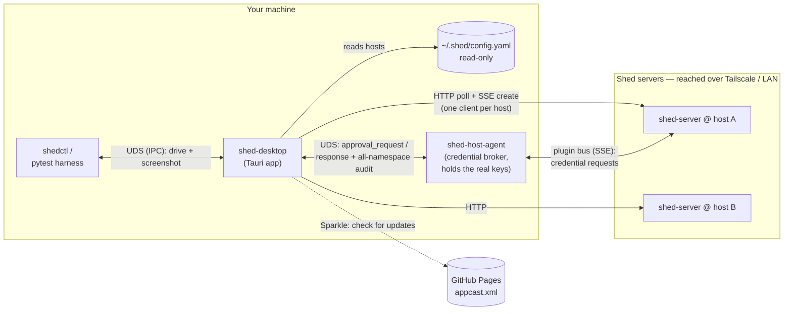

# Architecture

shed-desktop is a desktop app that ties the **shed** toolchain into one resident control
surface: it lists and controls sheds (VMs) across hosts, shows the agent sessions running in
them as [roost](../extensions/roost-session-hosts.md) rows with live
[craze and opencode lanes](agent-lanes.md), and brokers the credential-approval gate. By
default its **embedded broker** runs the credential brokering (SSH, AWS, Docker) in-process —
see [The embedded credential broker](#the-embedded-credential-broker); pointed at an external
`shed-host-agent` instead, it holds no credentials and only coordinates the daemon that does.
There is no remote-control (RC) launcher: the RC stack was retired, and agents start through
roost or craze.

The app is a **Tauri** client on both macOS and Linux, built from `desktop/tauri/src-tauri`
(bin `shed-desktop-tauri`). All protocol and app logic lives in the shared **Rust core**:
`shed-core` (the shed-server protocol layer — HTTP/SSE, decoding, control-token auth, TLS
pinning) and **`shed-app`**, the UI-free app-logic layer, with `shed-craze` and
`shed-opencode` as the agent-lane adapters — see [Rust core](rust-core.md). On Linux it ships
as the `shed-desktop` nfpm `.deb` (`/usr/bin/shed-desktop`, with a headless `shedctl` and the
polkit action alongside) via `charliek/apt-charliek` (`apt install shed-desktop`); on macOS as
the notarized DMG with Sparkle updates. A first-class design goal is that the app is
**drivable and observable by an automated agent** over an IPC socket — see [IPC](ipc.md).

## System context

shed-desktop sits between three other systems: the **shed servers** (one per host, over
HTTP), the **shed-host-agent** (the local credential broker, over a Unix-domain socket),
and the **shed CLI's config file** (read; the app only ever appends a `machines:` entry). It also serves its own control socket that
`shedctl` and the test harness drive, and checks GitHub Pages for Sparkle updates.



The diagram shows the external-daemon mode. In the default embedded mode the same broker runs
inside shed-desktop, with no Unix-domain-socket hop. With an external host-agent the app is
**never in the credential path**; with the embedded
broker (below) it is, since the broker runs in the app's process. A shed inside a VM asks its
shed-server for a credential (SSH signature, AWS creds, docker login); that request flows out
over the server's plugin bus to the broker, which holds the real keys. The approval gate only
sees request *metadata* and returns an approve/deny decision (see [the approval
flow](#the-host-agent-unix-domain-socket)).

## Structure

| Part | Where | Role |
|---|---|---|
| Rust shell | `desktop/tauri/src-tauri/src/` | The Tauri app: `lib.rs` (setup, the Tauri commands the UI invokes, mode selection), `ipc.rs` (the control socket and its op dispatch), `approval.rs` (the native Touch ID / polkit gate and notifier), `broker.rs` (credential-broker mode selection), `tray.rs` (tray menu + macOS popover), `updater.rs` (Sparkle, macOS), `roost_hosts.rs` / `machines.rs` / `lane.rs` / `craze.rs` (agent sessions and lanes), `termctl.rs` (terminal launch), `prefs.rs` (persisted preferences), `screenshot.rs`, `single_instance.rs`, `shutdown.rs`, `applog.rs` |
| Web UI | `desktop/tauri/ui/` | React + Vite + TypeScript: the dashboard (`App.tsx`), the Preferences window, the macOS tray popover, and the agent-lane panels. It reports what it rendered back to the shell, which is what the IPC `*.dump` ops answer from |
| Shared core | `crates/` | `shed-core` (protocol, config, approval policy model), `shed-app` (`Backend`, the approval `Coordinator`, `HostAgentClient`, `AuditStore`, roost hosts), `shed-broker` (the embedded broker), `shed-craze` / `shed-opencode` (lane adapters) — see [Rust core](rust-core.md) |
| `shedctl` | `crates/shedctl/` | A headless CLI for the control socket — see [shedctl](cli.md) |
| Bundled openers | `desktop/Resources/bin/` | `shed-open-ghostty` and `shed-open-roost.py`, the terminal presets' launch scripts, shipped as app resources |

The Tauri crate is its own cargo workspace (so its WebKitGTK/Tauri dependencies stay out of
`crates/`) and takes `shed-core` + `shed-app` as path dependencies.

## How the pieces connect

### Shed servers (HTTP)

`shed-app`'s `Backend` builds one `shed-core` client per host from the config and fans out to
all of them concurrently. Unreachable hosts degrade to a grey dot, never a hard failure of the
whole list.

| Call | Endpoint | Notes |
|---|---|---|
| Server info | `GET /api/info` | name, version, ports, backend |
| List sheds | `GET /api/sheds` | tolerates `{"sheds": null}` → `[]`; stamps the host name |
| Disk usage | `GET /api/system/df` | the **System** pane (per-host totals + entries) |
| Lifecycle | `POST /api/sheds/{name}/start\|stop\|reset`, `DELETE /api/sheds/{name}` | |
| Create | `POST /api/sheds` with `Accept: text/event-stream` | **SSE** stream: `progress…` → `complete` / `error` |

Shed lifecycle has **no push event stream**, so the dashboard **polls** `GET /api/sheds`
on an interval. SSE is used *only* for create-progress (which the server does stream). The
HTTP API has no auth and relies on network-level access control (Tailscale/firewall): the
app treats a reachable server as already trusted by the network and never exposes it
further.

### The host agent (Unix-domain socket)

This section describes the **external-daemon** path, one of the three broker modes (see [The
embedded credential broker](#the-embedded-credential-broker) below for the in-process path
and the mode selection between them).

The headline feature. When an extension is configured with `approval.policy: shed-desktop`,
`shed-host-agent` (which always serves the local Unix-domain socket) delegates
that extension's **approval** decisions to the app (SSH interactively; AWS/Docker as a live
Allow/Deny), while streaming an **all-namespace audit feed** (ssh-agent + aws-credentials +
docker-credentials) that the app surfaces in **Activity**. See [Credential
approvals](approvals.md) for the policy model.

- **Socket:** `host-agent.sock` in `~/Library/Application Support/shed/` on macOS, and in
  `$XDG_RUNTIME_DIR/shed/` (else `~/.local/share/shed/`) on Linux; `SHED_HOST_AGENT_SOCKET_DIR`
  moves the directory. `shed-app`'s `HostAgentClient` dials it, auto-reconnecting with
  0.5→5 s backoff.
- **Wire protocol** (newline-delimited JSON, `v=1`): app → agent `hello`,
  `approval_response`, `pong`; agent → app `hello_ack`, `approval_request`, `event`, `ping`.
  `hello_ack` advertises `namespaces`, `gate_namespaces`, `request_timeout_ms`.
- **Multi-server:** one agent can broker for many shed servers; `approval_request` and
  `event` frames carry a `server` field so identical shed names on different servers don't
  collide.
- **Fail-closed:** no connected app, a timeout, or a disconnect all resolve to *deny* — the
  same outcome as an unanswered local prompt. Only request metadata ever crosses the socket;
  the agent stays the sole key holder. The whole feature is **default-off** in the agent.

```mermaid
sequenceDiagram
    participant VM as shed VM (git push)
    participant SRV as shed-server
    participant HA as shed-host-agent
    participant SD as shed-desktop
    VM->>SRV: SSH-sign request (ssh-agent)
    SRV->>HA: deliver via plugin bus
    HA->>SD: approval_request (UDS)
    Note over SD: PolicyEngine.decide →<br/>auto / notification / Touch ID
    SD->>HA: approval_response (approve | deny)
    HA->>SRV: signature (or denial)
    SRV->>VM: result
    HA-->>SD: event (audit; all namespaces)
```

### The embedded credential broker

The app (macOS and Linux) can also run the credential broker **in-process** —
the same `shed-broker` Rust crate the standalone `shed-host-agent` daemon is built from,
embedded via `shed-app`'s non-default `broker` feature instead of dialed over a socket.
Quitting the app stops brokering (server-side fails closed, same as stopping the daemon);
there is no LaunchAgent/systemd unit for it.

**Mode selection.** A persisted preference (`Preferences → Credential broker`; wire value
`broker_mode`, default `auto`) resolved against a startup probe of both daemon sockets:

| Effective mode | When | Broker behavior |
|---|---|---|
| `external` | Pref `auto` + the daemon's desktop socket is live, or pref pinned to `external` | Dials the [external daemon](#the-host-agent-unix-domain-socket) above. |
| `headless-coexist` | Pref `auto` + only the daemon's *status* socket is live (a daemon run with `--no-default-features`, no desktop socket) | The app does **not** start its own bus broker (avoids per-namespace `409`s with the headless daemon) and gets no in-app approvals; it still self-mints its own secure-server tokens in-process. |
| `embedded` | Pref `auto` + neither socket is live, or pref pinned to `embedded` | The app starts its own in-process broker. Pinning `embedded` alongside a running daemon is allowed — the two race per server/namespace; the loser gets `409 NAMESPACE_ALREADY_REGISTERED`, surfaced (never hidden) in `broker.status`, never a double prompt. |

The mode is **fixed for the process lifetime** — it is resolved once at startup and never
hot-swapped. Changing the pref via Preferences (or `broker.set_mode` over IPC) persists
immediately but only takes effect on the next launch; until then, `broker.status` and
`identify.broker_mode` report `restart_required: true`. Both ops also echo the probe
evidence (`desktop_socket_live`, `status_socket_live`) so the UI can explain an `auto`
choice.

One consequence: if the daemon the app chose at launch (`external`) goes away while the app
runs, the app keeps trying to reach it and there is no credential broker until relaunch, so
the sheds it brokers lose ssh-agent and credential forwarding. After removing the daemon,
relaunch the app (or pin `In-app (embedded)`). A runtime fallback is tracked in
[#411](https://github.com/charliek/shed/issues/411).

**`extensions.yaml` handling.** The embedded broker reads the same
`~/.config/shed/extensions.yaml` the daemon does (see [Extensions →
Configuration](../extensions/configuration.md)), with two deliberate divergences from the
daemon (which exits 1 on either missing or invalid config):

- **Missing file** (fresh install) — the broker synthesizes a default config through the
  same parse/validate path a real file goes through, rather than exiting: discovery mode
  over `~/.shed/config.yaml` (every configured server), `ssh.mode: ""` (auto-detect),
  `ssh.approval.policy: shed-desktop` (routed to the in-app gate), and AWS/Docker left
  unconfigured — Docker is still subscribed (denying every registry until configured),
  AWS is not subscribed at all, matching the daemon's own empty-config behavior. Zero
  config files to hand-write for a working install.
- **Present but malformed/invalid** — the broker fails **closed**, not the app: no
  minting, no approvals, but the app keeps running. The parse/validation error surfaces in
  `broker.status` (`config.source: "error"`, `config.message`) and in the Preferences
  window. A file that parses and validates is honored **identically** to the daemon —
  same policies, allowlists, and discovery config.

`broker.status` distinguishes the three provenances via `config.source`: `"loaded"`
(a real file), `"synthesized"` (the fresh-install default), or `"error"`.

**SSH auto-detect is environment-dependent.** `ssh.mode: ""` (the default, in both the
synthesized config and a hand-authored one that omits `ssh.mode`) selects agent-forward
if `$SSH_AUTH_SOCK` is set, else local-keys — and a GUI app launched via login-item
autostart does not necessarily see the same environment a terminal-launched daemon does
(macOS launch agents and Linux desktop autostart entries commonly start with a trimmed
environment). The **resolved** mode — not the config's `ssh.mode` string — is exposed as
`broker.status.resolved_ssh_mode`, so a support session can tell agent-forward and
local-keys apart without guessing at the launch environment.

**Two durable audit logs.** In embedded mode, every approval decision is written to
**both** the broker's own configured `logging:` JSONL (parity with what the standalone
daemon writes, default `~/.local/share/shed/extensions-audit.log`) **and** the app's own
`audit.jsonl` (see [State + storage](#state-storage) below). The app's **Activity** pane
only ever reads its own store — the broker's log exists for daemon-equivalent
tooling/parity, not because the app needs two sources of truth.

**No sockets served.** The embedded broker exposes neither of the daemon's Unix-domain
sockets (§[Host Agent IPC](../extensions/host-agent-ipc.md)) — there is nothing external
to dial or probe against it. All observability goes through the app's own IPC
(`broker.status`, `identify.broker_mode`) instead.

### The shed CLI config

shed-desktop reads the **same config the `shed` CLI manages** — `~/.shed/config.yaml`
— to discover hosts. It parses it with `shed-core`'s tiny indentation reader (`ShedConfig`,
no YAML dependency), reading `servers:` (name → `host`, `http_port`, `ssh_port`, and the
secure-server fields) and `default_server`, plus the `machines:` section. The app never
writes `servers:`; its one write is the Machines pane's **Add machine**, which appends a
`machines:` entry after backing the file up. To add or remove hosts, use the `shed` CLI; the app reflects the
change on its next poll (the Preferences → Hosts section is a read-only mirror). A missing
config degrades to an empty host list, never a crash.

### The control socket (shedctl + the harness)

So the app is drivable/observable by an automated agent, `ipc.rs` serves a newline-JSON
socket at `$XDG_RUNTIME_DIR/shed-tauri.sock` (falling back to
`/tmp/shed-tauri-<uid>/shed-tauri.sock`; mode `0600`, with a sibling `shed-tauri.lock` for
single-instance — a second launch hands off to the running app with an `app.activate` op).
Both `shedctl` and the hermetic pytest harness (`desktop/tools/shedtest`) speak this exact
protocol — listing state, navigating panes, driving lifecycle/approvals, reading what the UI
rendered, and capturing PNG screenshots. This is the seam that lets every change be verified
by driving the real app, not by asking a human to click. See [IPC](ipc.md) and
[shedctl](cli.md).

## Windows + tray

The dashboard, the Preferences window and (on macOS) the tray popover are Tauri webview
windows over the one React UI. Both platforms get a native tray menu (Open Dashboard,
Approvals, Preferences, Quit). On macOS a left-click on the menu-bar icon opens the popover
and a right-click the menu; on Linux the menu is the whole tray surface, because Tauri emits
no tray-click events there. On macOS the app is an accessory (`LSUIElement`): no Dock icon
until a dashboard or Preferences window is open. Building the tray is best-effort — a headless
or no-StatusNotifier Linux session has nowhere to show it — and the dashboard window is always
reachable.

## Shutting down

The app ends every child process it owns from every way it can exit: the tray's or
the popover's Quit, SIGTERM, SIGINT and SIGHUP, and on macOS a Dock Quit, a logout or an
AppleScript `quit` (which reach the app only as Tauri's `RunEvent::Exit`). All of them run
one bounded, orderly shutdown, once — a later trigger waits for the run already going. Two
things deliberately cut it short: a **second** SIGTERM/SIGINT/SIGHUP, or the 20-second escape
timeout, exits the process at once, so a wedged shutdown can never hang a quit; children the
run had not reached by then are left to their own protocols (an ssh master's
`ControlPersist`, a bridge's stdin closing).

- **Nothing new starts once it begins.** The app holds one spawn gate, closed first. Every
  place the app starts a child — a craze bridge (local or over ssh), an ssh exec, an opencode
  `ssh -N -L` forward, a roost tunnel — takes a section of that gate across the spawn and the
  child's registration, so a spawn either finished before the close (and the shutdown ends
  it) or is refused with `shutting_down`; a spawn already under way when the close began
  that lands after it kills its own child at registration. The UI's own calls (a refresh,
  `lane.open`, `craze.create`, a bootstrap) are refused the same way.
- **Then it ends what it owns, in a fixed order, each step bounded:** the app's own roost
  watchers, probes and in-flight one-shots (a launch, a bootstrap, a tab close) are joined,
  and cancelled past a short bound (they are the only clients of a roost tunnel, so no
  connection can arrive while the tunnels close); the agent lanes and their forwards are
  closed (on a thread of their own, the forward children killed and reaped); the craze
  sources stop and every registered bridge child is killed and its exit seen, even one a
  transcript request is still holding; each roost tunnel runs its own teardown; and each ssh
  connection master is asked to exit — and, if it does not, is ended by its pid after
  checking that pid is the master on this app's control socket.
- **What the app does not own keeps running.** A craze hub and its sessions, and a remote
  `roost-session`, are left alone: a session started from the app is still there, and still
  attachable, after the app quits.

The worst case is about 16 seconds and the usual case is well under 3. Each step's time is
logged to stderr and to the app's log file (`shed-desktop-tauri: shutdown: phase N …`; the
file's location is under State + storage below), with anything it gave up on at its bound: work that could not finish in time is abandoned with the spawn gate still closed, so
nothing it starts later survives its registration. A second signal, or a
shutdown still running 20 seconds after the first signal, exits at once (status 128 + the
signal number). A crash or a `kill -9` runs none of this; an ssh master left behind then
exits on its own once its 60-second `ControlPersist` lapses.

## State + storage

| What | Where | Notes |
|---|---|---|
| Audit log | `audit.jsonl` in the app data dir: macOS `~/Library/Application Support/ai.stridelabs.ShedDesktop/`, Linux `${XDG_DATA_HOME:-~/.local/share}/ai.stridelabs.shed-desktop/` | append-only JSONL. Reachable over IPC via `activity.log_path`. |
| Preferences | `prefs.json` in the app config dir: macOS `~/Library/Application Support/ai.stridelabs.ShedDesktop/`, Linux `${XDG_CONFIG_HOME:-~/.config}/ai.stridelabs.shed-desktop/` | terminal preset + template, SSH approval prefs, AWS/Docker modes, per-shed rules, broker mode. See [Configuration](configuration.md). |
| Control socket + lock | `$XDG_RUNTIME_DIR/shed-tauri.{sock,lock}`, else `/tmp/shed-tauri-<uid>/` | `SHED_TAURI_SOCKET` moves the socket; the lock sits beside it. |
| Log | macOS `~/Library/Logs/ShedDesktop/shed-desktop.log`; Linux `${XDG_STATE_HOME:-~/.local/state}/ai.stridelabs.shed-desktop/shed-desktop.log` | The Tauri app's own lines, the shed crates' `tracing` events (INFO and up) and the embedded broker's lines (bus connects, drops and `409` rejections, each naming its `server=`), every line stamped `<RFC 3339 UTC> <LEVEL>` and also written to stderr. `SHED_TAURI_LOG=debug` raises the shed crates to DEBUG and adds roost-ipc's events, which are off without it. Rotates at 5 MiB, keeping `.log.1`–`.log.3`. The file is private (`0600`, under your own directories; those the app creates are `0700`) and holds host names, paths and diagnostic text; `SHED_TAURI_LOG=debug` adds roost's ssh diagnostics, which can include ssh's own stderr. `SHED_TAURI_LOG_FILE` overrides the path, which must name a regular file: a symlink there is refused, never followed, as is a FIFO or a device. `identify.log_path` reports the file in use (`null` when file logging is off — a destination that cannot be opened, or a failed write, falls back to stderr only, said once). Opened only once the single-instance lock is held, so a second launch that raises the running app never writes it; a launch whose lock check fails carries on with stderr only. A dev build run beside the installed app (a different `SHED_TAURI_SOCKET`) shares this default path; set `SHED_TAURI_LOG_FILE` to keep them apart. |

## Security model

The app holds **no credentials and no secrets** — it coordinates processes that do. The
credential-approval gate is **fail-closed** (a missing or unresponsive app denies, matching
the host agent's unanswered-prompt outcome), and the app only ever handles request metadata,
never key material. It adds no remote attack surface: it makes outbound HTTP/UDS connections
and serves one local `0600` socket. Sparkle auto-update authenticity rests on an **EdDSA
signature** over each release, independent of Apple notarization (see
[RELEASING](https://github.com/charliek/shed/blob/main/desktop/RELEASING.md)).
