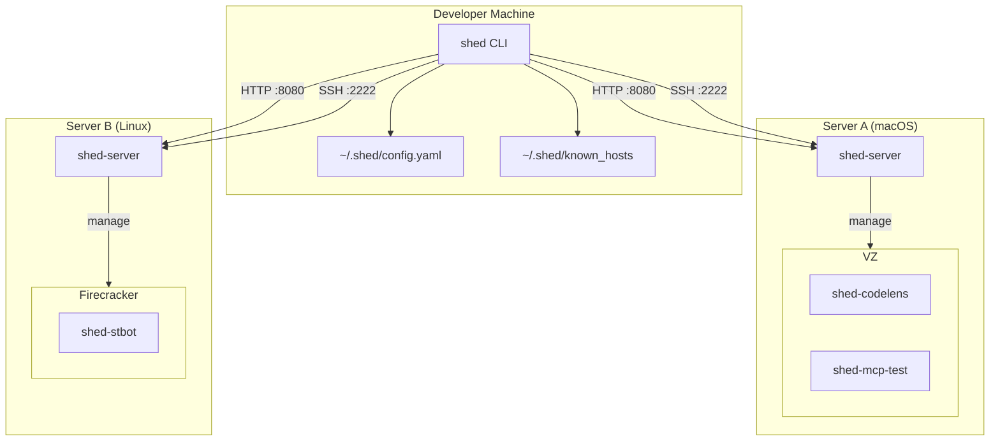
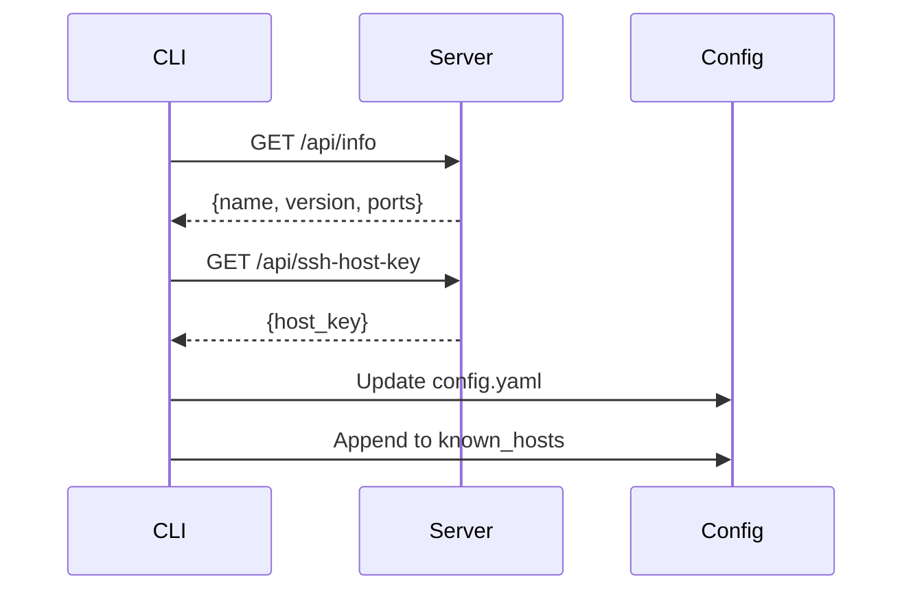
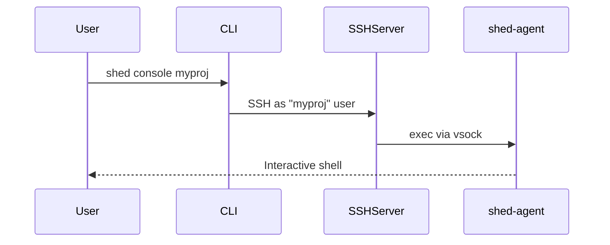
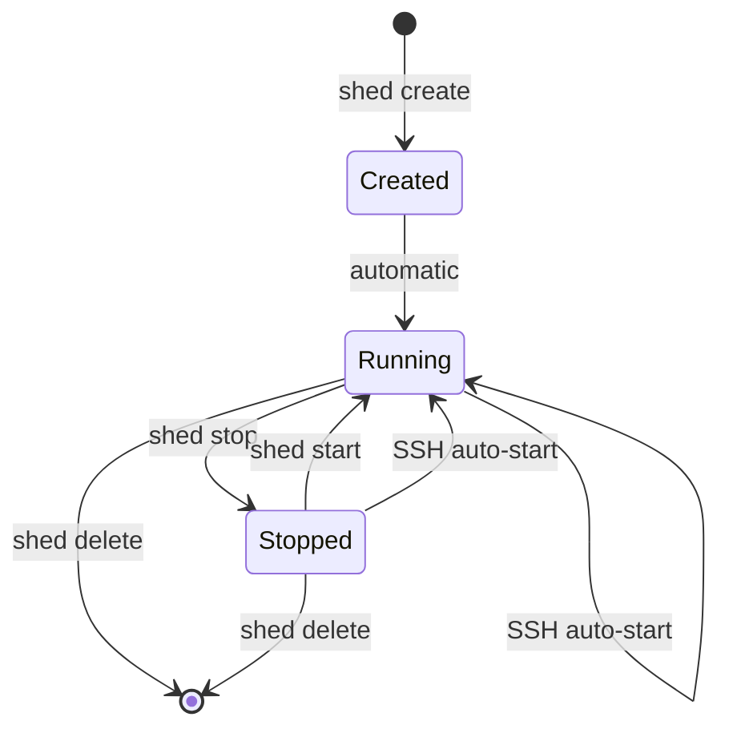

# Architecture

This document describes Shed's internal architecture and design decisions.

## System Overview



## Components

| Component | Description |
|-----------|-------------|
| `shed` | CLI binary for developer machines (macOS, Linux) |
| `shed-server` | Server binary exposing HTTP + SSH APIs (Linux, macOS) |
| `shed-agent` | Agent binary running inside Firecracker and VZ VMs (Linux) |

## Communication Protocols

| Protocol | Port | Purpose |
|----------|------|---------|
| HTTP | 8080 | REST API for CRUD operations, Connect API, server discovery (`open` mode only) |
| HTTPS | 8443 | The same API over pinned TLS in `token` and `mtls` mode (the only API listener there), including the HTTPS exec |
| SSH | 2222 | Terminal access (exec, attach), IDE remote connections |
| vsock | 1024 | VM console I/O (Firecracker, VZ) |
| vsock | 1026 | Message bus — health checks, plugins (Firecracker, VZ) |
| vsock | 1028 | TCP proxy — DialService tunnels into VM services (Firecracker, VZ) |

## Naming Conventions

| Resource | Format | Example |
|----------|--------|---------|
| VM | `shed-{name}` | `shed-codelens` |
| SSH Host | `shed-{name}` | `shed-codelens` (in SSH config) |

## Data Flows

### Server Discovery



### Shed Creation

For the user-facing lifecycle documentation (what happens at each step across all backends), see [Provisioning: Shed Lifecycle](../reference/provisioning.md#shed-lifecycle).

The diagrams below show the internal implementation flow for each backend.

=== "Firecracker"

    ```mermaid
    sequenceDiagram
        participant CLI
        participant Server
        participant VM as Firecracker VM
        participant Agent as shed-agent

        CLI->>Server: POST /api/sheds {name, repo, local_dir}
        Server->>Server: Copy base rootfs to instance dir
        Server->>Server: Allocate CID, TAP device, IP address
        Server->>VM: Spawn Firecracker process
        Server->>Agent: Wait for agent health (poll vsock:1026)
        Agent-->>Server: Healthy
        alt local-dir / add-dir specified
            Server->>Server: Start 9P TCP server on bridge IP
            Server->>Agent: Mount 9P shares at /home/shed/<basename>
        end
        Server->>Agent: Mount 9P configured directories (mounts)
        alt repo specified
            Server->>Agent: git clone via vsock exec
        end
        Server->>Agent: Run install hook via vsock exec
        Server->>Agent: Capture PATH → /etc/profile.d/
        Server->>Agent: Run startup hook via vsock exec
        Server-->>CLI: {name, status, ...}
        CLI->>CLI: Auto-sync default profile via SSH+tar
    ```

=== "VZ"

    ```mermaid
    sequenceDiagram
        participant CLI
        participant Server
        participant vfkit
        participant Agent as shed-agent

        CLI->>Server: POST /api/sheds {name, repo, local_dir}
        Server->>Server: Copy base rootfs to instance dir
        Server->>vfkit: Spawn vfkit with VirtioFS devices
        Note right of vfkit: Devices: rootfs, local-dir / add-dir shares,<br/>configured mount shares
        Server->>Agent: Wait for agent health (poll vsock:1026)
        Agent-->>Server: Healthy
        alt local-dir / add-dir specified
            Server->>Agent: Mount VirtioFS shares at /home/shed/<basename>
        end
        Server->>Agent: Mount VirtioFS configured directories (mounts)
        alt repo specified
            Server->>Agent: git clone via vsock exec
        end
        Server->>Agent: Run install hook via vsock exec
        Server->>Agent: Capture PATH → /etc/profile.d/
        Server->>Agent: Run startup hook via vsock exec
        Server-->>CLI: {name, status, ...}
        CLI->>CLI: Auto-sync default profile via SSH+tar
    ```

### Mount Mechanisms

The server-config `mounts:` section (which falls back to the deprecated `credentials:` key when absent) binds host directories into a VM: the shed's selected mounts (`--mounts`, stored in its metadata; all of them by default), on every start. Each backend handles them differently based on its isolation model. All mount sources must be directories.

**Firecracker** — Mounts are bound via 9P over the TAP bridge network. Each mount directory gets a TCP-based 9P server on the bridge IP. Changes are immediately visible on both sides.

**VZ** — Mounts are bound via VirtioFS. Each mount directory gets a VirtioFS share added as a vfkit device argument at VM launch, then mounted inside the guest. Changes are immediately visible on both sides.

### SSH Connection



## DialService and Connect API

`DialService` is the foundational primitive for opening TCP connections into VMs. It abstracts the per-backend connectivity:

- **VZ:** Dials the vsock TCP proxy port (1028) via a Unix socket, performs a CONNECT handshake (`CONNECT <port>\n` / `OK\n`), and returns a raw connection to the target port inside the VM.
- **Firecracker:** Dials the same vsock TCP proxy port (1028) through the Firecracker vsock UDS mux, then performs the same tcpproxy CONNECT handshake. (Historically FC dialed the VM's routable bridge IP directly; it now routes through the guest agent's TCP proxy for parity with VZ, so loopback-bound guest services such as the rc hub are reachable and the peer address the guest sees is `127.0.0.1`.)

The **Connect API** (`GET /api/sheds/{name}/connect/{port}`) exposes `DialService` to external processes via HTTP upgrade (101 Switching Protocols). After the upgrade, the connection is a raw bidirectional byte stream.

**Consumers:**

- `shed tunnels` CLI — opens local ports, bridges connections through Connect API
- SSH port forwarding (`handleDirectTCPIP`) — uses `DialService` directly (same process)
- Proxy extension (`shed-ext-proxy`) — uses Connect API for reverse proxying

**Two primitives for two jobs:**

- TCP tunneling (ports, services, proxy): Connect API / `DialService`
- Interactive sessions (exec, attach): SSH / vsock binary framed protocol

A third path runs one command without SSH: `POST /api/sheds/{name}/exec`
takes an argv over the HTTPS API, runs it through the guest agent's exec over
vsock (the same `AgentClient.Exec` SSH sessions use), and streams NDJSON
`stdout`/`stderr` frames and an `exit` frame back. It is what service clients
(orchestrators) use, and admins can too.

## Internal Packages

### `internal/api`

HTTP API handlers and routing. Uses standard `net/http` with Chi router. Includes the Connect API endpoint for TCP tunneling, the HTTPS exec endpoint (`exec.go`), service-client authorization (`clientauth.go`: a fixed route allowlist and per-shed ownership) and create policy (`policy.go`), the audit hooks (`audit.go`), and the `max_age` reaper that deletes service clients' expired sheds (`reaper.go`).

### `internal/config`

Configuration types and loading for both client and server configs.

### `internal/sshd`

SSH server implementation using `gliderlabs/ssh`. Routes connections to VMs based on username.

### `internal/sshconfig`

Parses and generates SSH config files. Manages the shed-specific block in `~/.ssh/config`.

### `internal/vmutil`

Shared VM agent communication code used by both Firecracker and VZ backends. Contains the `Dialer` interface (the core abstraction differing between backends), `AgentClient` (exec, health checks), `NotifyConn` (persistent auto-reconnecting connections), and provisioning. No build tags -- all platform-specificity lives in the `Dialer` implementations.

### `internal/firecracker`

Firecracker backend (Linux only): VM lifecycle via Firecracker SDK, TAP networking, rootfs management, metadata persistence. Implements `vmutil.Dialer` with the CONNECT/OK vsock handshake over a single Unix socket.

### `internal/vz`

VZ backend (macOS Apple Silicon only): VM lifecycle via vfkit subprocess, NAT networking, rootfs management, metadata persistence. Implements `vmutil.Dialer` with direct per-port Unix socket connections (no handshake needed).

### `internal/netpolicy`

The `isolated` network profile on Firecracker: renders this server's two nftables tables (`bridge` and `inet shed_<name>`) from the guarded sheds' TAP, MAC and IP, applies them with `nft -f -` in one transaction, and tracks the desired state so the backend's 30 s check can reapply them. It never touches the bridge, the NAT rules or another table.

### `internal/audit`

The JSON Lines audit log, `audit.jsonl` (service-client requests, HTTPS execs, reaps), written `0600` and rotated at 50 MiB.

### `internal/servertls`

The server's self-signed TLS certificate, the mtls client CA, client-certificate verification, and service-client certificates (`service.go`: their shape, `shed-server client issue`'s signing, and the handshake check against `auth.clients`).

### `internal/plugin`

Extension/plugin message bus. Defines the message envelope, namespace registry, and bridge (connects API to per-shed vsock connections). See [Extensions](../reference/extensions.md).

### `internal/agentproto`

Binary protocol for framed messages over vsock between shed-server and shed-agent. Message types cover exec, file transfer, health checks, and plugin messages.

### `internal/backend`

Backend interface that Firecracker and VZ backends implement.

### `internal/provision`

Handles in-repo provisioning hooks (`.shed/provision.yaml`).

### `internal/sync`

Client-side file synchronization to VMs.

### `internal/tunnels`

Connect API-based tunnel management for port forwarding.

## Security Model

- **Postures:** `open` (the default, loopback-bound, no credential), `token` and `mtls` (pinned TLS, an HTTP credential and an enforced SSH key allowlist). Service clients, in `mtls` mode, reach only their own sheds.
- **Per shed:** a mount selection and, on Firecracker, the `isolated` network profile limit what a guest reaches. Workloads run as the `shed` user (UID 1000) with passwordless sudo.
- Built for one owner; not multi-tenant. The full model is in [Security](../reference/security.md).

## Shed Lifecycle



A shed a service client owns has one more exit: once it is older than the client's `max_age`, the reaper (at `serve` start, then every 60 s) stops and deletes it.

## File Locations

### Client

| Path | Purpose |
|------|---------|
| `~/.shed/config.yaml` | Server list, defaults, cached sheds |
| `~/.shed/known_hosts` | SSH host keys |
| `~/.shed/sync.yaml` | File sync configuration |
| `~/.shed/tunnels.yaml` | Tunnel profiles |

### Server

| Path | Purpose |
|------|---------|
| `/etc/shed/server.yaml` | Server configuration |
| `{state_dir}/` | Identity material: `host_key`, `tls_cert.pem`/`tls_key.pem`, the mtls client CA (`ca_cert.pem`/`ca_key.pem`) and `github_keys/`. `state_dir` defaults to `/etc/shed` as root and `~/.shed` otherwise |
| `~/.shed/env` (`env_file`) | Variables passed to the in-VM `git clone` of `repo` (never for a service client's sheds) |
| `<instance_dir parent>/audit.jsonl` | Audit log: service-client requests, HTTPS execs, reaps (`/var/lib/shed/firecracker/audit.jsonl` by default) |
| `<instance_dir parent>/egress-audit.jsonl` | Egress-proxy decisions, when egress is enabled |
