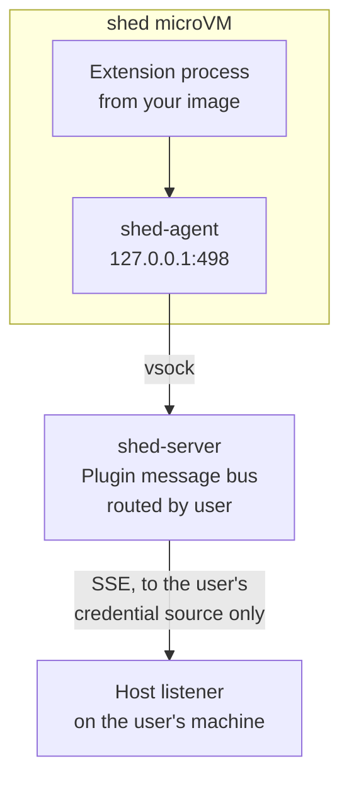

# Extensions Architecture

Shed's plugin message bus lets a process in a shed talk to a process on the user's own
machine, routed by the shed server. This page traces the component layout, the message flow,
and where the pieces live in the repository. The bus is generic: shed ships no extension of
its own on it. (Credentials used to run on it; since v0.11 they reach a shed by
[credential delivery](../reference/delivery.md) instead.)

## Component Overview

## Message Flow

1. A process in the shed POSTs a JSON envelope to `http://127.0.0.1:498/v1/publish`, the
   shed-agent's HTTP endpoint.
2. shed-agent sends the message over vsock to shed-server.
3. shed-server stamps the envelope with its own record of the shed, replaces the guest's
   request id with one it mints, and routes it to the namespace's listener of the **shed's
   user**. That listener exists only on the user's [credential source](source-binding.md);
   with no listener the request is dropped and logged.
4. The listener processes the request and POSTs a response to
   `/api/plugins/listeners/{namespace}/respond`, carrying the minted id in `in_reply_to`.
5. shed-server accepts the response only from the bound machine, for a request it sent that
   machine, and passes it back over vsock to shed-agent, which answers the publish call.

The wire format, the headers a listener sends and every refusal code are in the
[Extensions reference](../reference/extensions.md).

## Package Structure

All bus code lives in the shed monorepo.

### Server and guest

- **`internal/plugin/`**: the bus. It holds listeners per user and namespace, admits a
  machine only if it is the user's credential source, and matches each response to the
  request it answers. It backs the `/api/plugins` routes.
- **`cmd/shed-agent/`**: the in-VM agent. It runs the local publish proxy on
  `127.0.0.1:498`, forwards messages over vsock, reads the manifests in
  `/etc/shed-extensions.d/` and activates the enabled extensions' systemd units, and reports
  each extension's health in its heartbeat.
- **Credentials scope**: the bus routes need a credentials-scope certificate (see
  [Security](../reference/security.md)); a script key's certificate is refused.

### SDK

- **`sdk/envelope.go`**: the envelope (`sdk.Envelope`, `sdk.ShedInfo`) and the message types.
  `internal/plugin` uses the same types as aliases, so the server and the guest share one
  definition.
- **`sdk.BusClient`**: the guest-side HTTP publisher to shed-agent.
- **`sdk.HostClient`**: the host-side SSE subscriber to shed-server, with machine identity,
  reconnect and the credential-source refusals (`*sdk.SourceError`).

The desktop app's Rust crate `crates/shed-source` has its own client of the same endpoints
for its delivery stream; it does not subscribe to any bus namespace.

## The health frame

The first message of an agent's connection is `system:health`. The server answers with the
list of enabled extensions from its config, and the agent reads that list to decide which
manifest units to enable. After that the agent's heartbeat carries each enabled
extension's `guest` state (is the unit active) and `host` state (does a bus ping reach a
listener).

## Distribution

| Component | Channel |
|-----------|---------|
| `shed-server` (the bus) | The server package (brew, apt) |
| `shed-agent` | Baked into the rootfs images (`base`, `full`) and the cloud image |
| `sdk` | The Go module `github.com/charliek/shed/sdk` |

The images carry no extension manifest and no extension unit. To add one, build your own
image from `base` or `full` (see [Build Your Own Image](../tutorials/build-your-own-image.md)),
install its binary, unit and a manifest in `/etc/shed-extensions.d/`, and name its namespace
in `extensions.enabled`.

## Security Boundaries

| Boundary | Rule |
|----------|------|
| Guest to server | Anything in the shed can publish on the bus. The server replaces the envelope's `shed` object and id, so a guest cannot claim to be another shed. |
| Server to listener | Only the shed's user's credential source receives the message. Another of the user's machines is refused and keeps retrying. |
| Listener to server | A response is accepted only from the machine that was sent the request, under the current binding. |
| Service clients and script keys | A shed owned by a service client has the bus off. A script key's certificate cannot subscribe or respond. |
