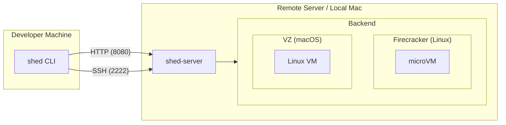

# Shed

Shed is a lightweight tool for managing persistent, VM-based development environments across multiple servers. It enables developers to spin up isolated coding sessions with AI tools (Claude Code, OpenCode) pre-installed, disconnect, and reconnect later to continue work.

## Features

- **Simple CLI** - Create and manage dev environments with minimal commands
- **Session Persistence** - VMs keep running after disconnect
- **Multi-Server** - Manage sheds across home servers and cloud VPS instances
- **IDE Integration** - Native Cursor/VS Code support via SSH Remote
- **AI-Ready** - Pre-configured for Claude Code and OpenCode workflows
- **VM Backends** - Firecracker microVMs (Linux) or Apple VZ virtual machines (macOS Apple Silicon)
- **Hardened Sheds** - `--mounts none` keeps host directories out of a shed, and on Firecracker `--network isolated` lets it reach the internet and nothing else, enforced by nftables on the host
- **Orchestrator API** - mTLS service clients that create, run commands in (`POST /api/sheds/{name}/exec`) and delete only their own sheds, within a policy

## Architecture

Shed consists of two binaries:

- **`shed`** - CLI for developer machines (macOS, Linux)
- **`shed-server`** - Server daemon exposing HTTP API (port 8080) and SSH server (port 2222)

The server runs one backend based on the platform:

- **VZ** - Uses Apple Virtualization.framework VMs via vfkit (macOS Apple Silicon)
- **Firecracker** - Uses microVMs with vsock communication (Linux with KVM)

Set `default_backend: detect` to auto-select based on platform, or specify `vz` or `firecracker` explicitly.

## Requirements

| Component | Requirements |
|-----------|--------------|
| Client | macOS or Linux (Go 1.27+ to build from source) |
| Server (VZ) | macOS 13+ (Ventura) on Apple Silicon (arm64) |
| Server (Firecracker) | Linux with KVM support |
| Network | Tailscale (or any private network) connecting all machines |

## Quick Links

- [Quick Start](getting-started/quick-start.md) - Get up and running
- [CLI Reference](reference/cli.md) - All commands and options
- [Configuration](reference/configuration.md) - Client and server config
- [VZ Setup](getting-started/vz-setup.md) - Set up VZ backend (macOS)
- [VZ Operations](reference/vz-operations.md) - Using VZ sheds
- [Firecracker Setup](getting-started/fc-setup.md) - Set up Firecracker backend
- [Firecracker Operations](reference/fc-operations.md) - Using Firecracker sheds
- [Security Configuration](guides/security-configuration.md) - Choosing a server posture and hardening sheds
- [Security](reference/security.md) - The security model, service clients and network profiles
- [Orchestrated Sheds](guides/orchestrated-sheds.md) - Driving sheds from CI or an agent runner
- [HTTP API](reference/api.md) - Every endpoint, including the HTTPS exec
- [Roadmap](ROADMAP.md) - Future enhancements

## Security Model

- **Local by default.** The server binds loopback and runs in `open` mode until you change it.
- **`token` or `mtls` for anything networked.** Both enforce pinned TLS, an HTTP credential and an SSH key allowlist; `mtls` is recommended. See [Security Configuration](guides/security-configuration.md).
- **Per-shed hardening.** `shed create --mounts none` keeps the server's host directories out of a shed, and `--network isolated` (Firecracker) limits it to the internet. See [Mount selection](reference/security.md#mount-selection) and [Network profiles](reference/security.md#network-profiles).
- **Service clients for orchestrators.** In `mtls` mode a CI system or agent runner can get a certificate that reaches only its own sheds. See [Service clients](reference/security.md#service-clients).

Shed is built for one owner and the machines they control. A service client is a narrow identity, not tenant isolation, so shed is **not suitable for multi-tenant use**. The full model is in [Security](reference/security.md).
