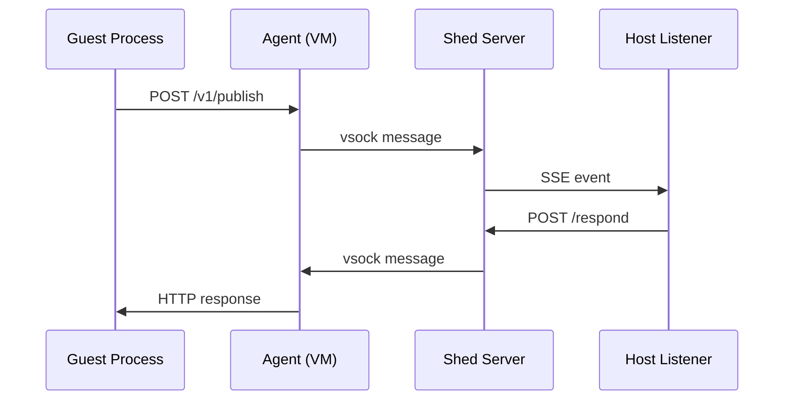

# Extensions

Shed provides a namespaced message bus for communication between processes inside VMs and external processes on the host. This enables building plugins that extend shed's functionality without modifying shed itself.

## Overview

The extension system works by routing messages between guest and host:

1. A process inside the VM publishes a message to a **namespace** (e.g., `op` for 1Password)
2. The shed agent forwards it over vsock to the shed server
3. The server delivers it via SSE to the **host-side listener** for that namespace of the
   shed's **user**; a listener is admitted only from the user's
   [credential source](../extensions/source-binding.md) machine
4. The listener processes the request and sends a response back, which the server accepts
   only from that machine



## Message Envelope

All messages use a common JSON envelope:

```json
{
  "id": "019abc12-3456-7def-8901-234567890abc",
  "namespace": "op",
  "type": "request",
  "in_reply_to": "",
  "final": true,
  "timestamp": "2026-03-29T12:00:00Z",
  "payload": {},
  "shed": {
    "name": "my-dev",
    "backend": "vz",
    "server": "mini"
  }
}
```

| Field | Type | Description |
|-------|------|-------------|
| `id` | string | UUIDv7 identifier chosen by the sender. For a request, the server replaces it with an id it mints before delivery; a listener answers with that id in `in_reply_to`, and the guest receives its own id back |
| `namespace` | string | Routing key (e.g., `op`, `proxy`). `system:*` is reserved. |
| `type` | string | `request`, `response`, or `event` |
| `in_reply_to` | string | For responses: the `id` of the original request |
| `final` | boolean | Whether this is the last response for a request |
| `timestamp` | string | RFC 3339 timestamp |
| `payload` | object | Namespace-specific data (opaque to shed) |
| `shed` | object | Shed metadata (`name`, `backend`, `server`), set by the server from its own record of the shed; anything the guest put there is replaced |

## Publishing from Inside a VM

The shed agent runs an HTTP API on `127.0.0.1:498` inside every VZ and Firecracker VM.

### Send a request (wait for response)

```bash
curl -s http://127.0.0.1:498/v1/publish -d '{
  "namespace": "op",
  "payload": {"action": "read", "item": "github-token"}
}'
```

The agent blocks until the host listener responds, for at most 30 seconds. The response envelope is returned as the HTTP body. (The credential helpers set their own, shorter client timeout: 3 seconds per request.)

If the shed's user has no listener for the namespace (no machine connected, or the user's credential source is offline), the server drops the request and logs it; the publish then ends with `504 TIMEOUT`, or earlier at the caller's own timeout.

### Send an event (fire-and-forget)

```bash
curl -s http://127.0.0.1:498/v1/publish -d '{
  "namespace": "proxy",
  "type": "event",
  "payload": {"action": "register", "port": 8080}
}'
```

Returns `202 Accepted` immediately.

### Error responses

| Status | Code | Meaning |
|--------|------|---------|
| 400 | `INVALID_BODY` | Malformed JSON |
| 400 | `MISSING_NAMESPACE` | Namespace field is empty |
| 400 | `INVALID_TYPE` | `type` is not `request` or `event` |
| 500 | `SEND_FAILED` | The message could not be sent to the server |
| 502 | `INVALID_RESPONSE` | The response could not be encoded |
| 503 | `NO_CONNECTION` | Agent has no active vsock connection to host |
| 503 | `CONNECTION_LOST` | The connection to the server ended while waiting |
| 503 | `SHUTTING_DOWN` | The agent is shutting down |
| 504 | `TIMEOUT` | No response within 30s |

## Building a Host-Side Listener

A host-side listener subscribes to a namespace via SSE and receives messages from the running sheds of **its caller's user**, except a shed a [service client](security.md#service-clients) owns: the bus is always off for those, so their messages are dropped and they never appear here. There is one listener per user per namespace, and every subscribe and response must name the machine it comes from in two headers; only the user's credential source is admitted (see [Credential Source](../extensions/source-binding.md)). A caller authenticates as for any other route: a client certificate on an `mtls` server, nothing on an `open` server (which listens on loopback only). A script key's certificate cannot subscribe or respond.

| Header | Value |
|---|---|
| `X-Shed-Machine-Id` | 32 lowercase hexadecimal characters, stable for the machine |
| `X-Shed-Machine-Name` | the machine's display name, percent-encoded UTF-8 (1 to 63 bytes decoded, no control characters) |

### Subscribe to a namespace

```bash
curl -N -H "Accept: text/event-stream" \
  -H "X-Shed-Machine-Id: 0f3c9a2e7b1d4c6a8e5f2b9d1c7a3e60" \
  -H "X-Shed-Machine-Name: laptop" \
  http://localhost:8080/api/plugins/listeners/op/messages
```

Messages arrive as SSE events:

```text
event: message
data: {"id":"...","namespace":"op","type":"request","payload":{...},"shed":{"name":"my-dev","backend":"vz","server":"mini"}}
```

### Send a response

When you receive a request, respond by POSTing back to the server, from the same machine. Put the request's `id` (the one the server sent) in `in_reply_to`, and include the shed name:

```bash
curl -X POST http://localhost:8080/api/plugins/listeners/op/respond \
  -H "Content-Type: application/json" \
  -H "X-Shed-Machine-Id: 0f3c9a2e7b1d4c6a8e5f2b9d1c7a3e60" \
  -H "X-Shed-Machine-Name: laptop" \
  -d '{
    "namespace": "op",
    "type": "response",
    "in_reply_to": "019abc12-...",
    "final": true,
    "shed": {"name": "my-dev"},
    "payload": {"token": "ghp_..."}
  }'
```

### Go client example

```go
package main

import (
    "bufio"
    "encoding/json"
    "fmt"
    "net/http"
    "strings"
)

func main() {
    req, _ := http.NewRequest("GET",
        "http://localhost:8080/api/plugins/listeners/op/messages", nil)
    req.Header.Set("Accept", "text/event-stream")
    req.Header.Set("X-Shed-Machine-Id", "0f3c9a2e7b1d4c6a8e5f2b9d1c7a3e60")
    req.Header.Set("X-Shed-Machine-Name", "laptop")

    resp, err := http.DefaultClient.Do(req)
    if err != nil {
        panic(err)
    }
    defer resp.Body.Close()

    scanner := bufio.NewScanner(resp.Body)
    for scanner.Scan() {
        line := scanner.Text()
        if strings.HasPrefix(line, "data: ") {
            data := strings.TrimPrefix(line, "data: ")
            var env map[string]any
            json.Unmarshal([]byte(data), &env)
            fmt.Printf("Message from shed %s: %v\n",
                env["shed"].(map[string]any)["name"], env["payload"])
        }
    }
}
```

## Server API Reference

All endpoints are under the shed server's HTTP API (default port 8080).

### List active listeners

```
GET /api/plugins/listeners
```

```json
{
  "listeners": [
    {"namespace": "op", "user": "alice", "created_at": "2026-03-29T12:00:00Z"}
  ]
}
```

A caller sees its own user's listeners; an admin sees every user's. `user` is omitted for the implicit user of a server with no user list.

### Subscribe to namespace (SSE)

```
GET /api/plugins/listeners/{namespace}/messages
```

Registers the calling machine as its user's listener for the namespace and streams that user's messages as SSE events, with a `: keepalive` comment every 25 seconds while idle. Each write to the stream has a 15-second deadline; a stream that misses it is closed and its listener removed. Another user's listener for the same namespace is independent.

| Status | Code | Meaning |
|--------|------|---------|
| 400 | `INVALID_NAMESPACE` | The namespace name is not valid |
| 403 | `FORBIDDEN` | The caller is not a user (a service client), or the request was made with a script key |
| 403 | `NAMESPACE_RESERVED` | `system:*` namespaces cannot be registered |
| 403 | `SOURCE_MACHINE_ID_REQUIRED` | No valid machine headers (a broker older than credential sources) |
| 403 | `SOURCE_NOT_BOUND` | Another machine is the user's credential source; `source.machine_id` and `source.machine_name` name it |
| 409 | `SOURCE_DUPLICATE_STREAM` | This machine already holds the namespace for this user; retry later |
| 429 | `SOURCE_RATE_LIMITED` | Too many new or changed machines for the user lately; `Retry-After` says when to retry |
| 500 | `INTERNAL_ERROR` | The binding could not be saved; nothing was registered |
| 503 | `PLUGINS_DISABLED` | The server has no credential bus, or is shutting down |

A refusal body is the API's usual `{"error": {"code", "message"}}`, under 1024 bytes.

### Respond to a message

```
POST /api/plugins/listeners/{namespace}/respond
```

Sends a response envelope back to the originating shed. The envelope must include `shed.name`, and its `in_reply_to` must be the id the server sent with the request. It is accepted only from the machine the request was sent to, while that machine is still the user's credential source. A final response is consumed once it has been written into the shed; an answer to a request that is no longer held is refused.

| Status | Code | Meaning |
|--------|------|---------|
| 204 | | Response delivered |
| 400 | `INVALID_BODY` | The body is not a JSON envelope |
| 400 | `MISSING_SHED` | Envelope missing `shed.name` |
| 403 | `FORBIDDEN` | The response matches no pending request of the caller's user for this namespace and shed; or the caller is not a user, or used a script key |
| 403 | `SOURCE_MACHINE_ID_REQUIRED` | No valid machine headers |
| 403 | `SOURCE_NOT_BOUND` | This machine is not (or no longer) the user's credential source |
| 404 | `SHED_NOT_CONNECTED` | The write into the shed failed; not retryable |
| 413 | `REQUEST_TOO_LARGE` | The body is larger than the shed can take |
| 429 | `TOO_MANY_RESPONSES` | The shed already has 8 responses in flight; `Retry-After: 1` |
| 503 | `RESPONSE_NOT_DELIVERED` | The shed did not take the response in time; nothing was written; `Retry-After: 1` |

### List connected sheds

```
GET /api/plugins/sheds
```

```json
{
  "sheds": [
    {"name": "my-dev", "backend": "vz", "server": "mini", "user": "alice"}
  ]
}
```

A caller sees its own user's sheds; an admin sees every user's. `user` is omitted for the
implicit user. A shed a service client owns is left out of this list, and a response sent to
it is refused.

## Extension Management

Extensions can be selectively enabled via server configuration. The agent reads extension manifests from the VM image and activates only the configured ones.

### Server Configuration

```yaml
extensions:
  enabled:
    - ssh-agent
    - aws-credentials
```

When `extensions` is omitted from the config, no extensions are activated.

### Extension Manifests

Each extension provides a manifest file in `/etc/shed-extensions.d/`:

```yaml
# /etc/shed-extensions.d/ssh-agent.yaml
namespace: ssh-agent
systemd_unit: shed-ext-ssh-agent.service
description: SSH agent forwarding via shed message bus
```

| Field | Required | Description |
|-------|----------|-------------|
| `namespace` | Yes | Plugin namespace (must match server config) |
| `systemd_unit` | Yes | Systemd unit to enable |
| `description` | No | Human-readable description |

### Activation Flow

1. Server sends the enabled extensions list in the health handshake
2. Agent reads manifests from `/etc/shed-extensions.d/`
3. Agent runs `systemctl enable --now` for each enabled extension
4. Extensions not in the enabled list remain inactive

Extensions are **enable-only** — they persist until VM restart. Runtime disabling is not supported.

### Extension Health

The agent periodically checks each enabled extension at two levels:

- **guest**: Is the systemd service running? (`systemctl is-active`)
- **host**: Can the extension reach the credential broker end-to-end? (bus ping round-trip)

Health status is included in heartbeats and visible via `shed list -vv`:

```text
Extensions:
  aws-credentials:     guest=running  host=connected
  ssh-agent:           guest=running  host=connected
```

### Naming Convention

| Component | Pattern | Example |
|-----------|---------|---------|
| Guest binary | `shed-ext-<namespace>` | `shed-ext-ssh-agent` |
| Systemd unit | `shed-ext-<namespace>.service` | `shed-ext-ssh-agent.service` |
| Manifest | `<namespace>.yaml` | `ssh-agent.yaml` |
| Host binary | `shed-ext-<purpose>-host` | `shed-ext-credentials-host` |

### SDK

The `github.com/charliek/shed/sdk` Go module provides shared types and clients for building extensions:

- `sdk.Envelope` — Universal message format
- `sdk.BusClient` — Guest-side HTTP publisher to shed-agent
- `sdk.HostClient` — Host-side SSE subscriber to shed-server. The Rust broker in `crates/shed-broker` is the maintained host-side client

```go
import "github.com/charliek/shed/sdk"

// Guest-side: publish a request
bus := sdk.NewBusClient(sdk.DefaultPublishURL, sdk.DefaultBusTimeout)
resp, err := bus.Publish(ctx, "my-namespace", payload)

// Host-side: subscribe to messages, as this machine
host := sdk.NewHostClient(
    sdk.WithServerURL("http://localhost:8080"),
    sdk.WithMachine("0f3c9a2e7b1d4c6a8e5f2b9d1c7a3e60", "laptop"),
)
ch := host.Subscribe(ctx, "my-namespace")
for env := range ch {
    // handle message, send response
    host.Respond(ctx, "my-namespace", responseEnv)
}
```

`sdk.WithMachine(id, name)` gives the client its machine identity, sent on every subscribe and respond in `X-Shed-Machine-Id` and `X-Shed-Machine-Name` (the name percent-encoded the same way the Rust broker encodes it). The id is 32 lowercase hexadecimal characters and must stay the same for the machine: a new id is a new machine to the server, so store it rather than generating one per process. The name is 1 to 63 bytes of UTF-8 with no control characters. `sdk.ValidateMachine(id, name)` applies the server's rules. A client built with an identity that breaks them sends nothing: `Respond` returns an error wrapping `sdk.ErrInvalidMachine`, and the subscription stops with state `rejected`. Without `WithMachine` the client sends neither header, and a server with credential sources refuses it with `403 SOURCE_MACHINE_ID_REQUIRED`. The client never invents an identity, because the caller decides which machine answers for its user.

The server's credential-source refusals come back as `*sdk.SourceError`. `Respond` returns it, and a subscription reports it in `Status()` (field `Err`). Match each refusal with `errors.Is`, and read its fields with `errors.As`:

| Sentinel | Status and code | Fields | Subscription |
|----------|-----------------|--------|--------------|
| `sdk.ErrSourceNotBound` | 403 `SOURCE_NOT_BOUND` | `MachineID`, `MachineName`: the user's credential source (empty when there is none) | retried on the backoff |
| `sdk.ErrSourceMachineIDRequired` | 403 `SOURCE_MACHINE_ID_REQUIRED` | | retried on the backoff |
| `sdk.ErrSourceDuplicateStream` | 409 `SOURCE_DUPLICATE_STREAM` | | retried on the backoff (any other 409 still ends the subscription as `rejected`) |
| `sdk.ErrSourceRateLimited` | 429 `SOURCE_RATE_LIMITED` | `RetryAfter`, from the `Retry-After` header in whole seconds, at most 10 minutes | retried after `RetryAfter` (at most 10 minutes) or the backoff, whichever is longer |

A refusal is recognised only from a complete body of at most 1024 bytes, that ends within 3 seconds, whose status and `error.code` match a row above. A subscribe's other 409, a legacy one without a code included, is the separate terminal error that ends the subscription as `rejected`. Any other non-success answer is reported as before, as an `unexpected status` error.

The client follows a redirect only within the configured server's origin (the same scheme, host name and port, so never from `https` to `http`), at most three times, whatever the `CheckRedirect` of a client passed with `sdk.WithHTTPClient` allows. Any other redirect is reported as an `unexpected status` error, and nothing is sent to where it points.

## Credential extensions

The `extensions` and `full` images come with shed's credential extensions pre-installed, providing SSH agent forwarding, AWS credential proxying, and Docker credential brokering. `extensions` is the lightweight starting point (base OS + credential extensions + Docker creds helper, no coding agents); `full` layers the coding agents on top. Create a shed with `--image extensions` (or `--image full` for the kitchen-sink default), enable extensions in your server config, and run the shed desktop app, which is the credential broker, on your machine.

These extensions are concrete implementations built on the plugin bus above, and their source lives in this repository (`cmd/shed-ext-*`, `internal/ext/` for the guest side; `crates/shed-broker` for the host-side broker). See the Extensions reference for setup and usage:

- [Architecture](../extensions/architecture.md) — component layout and message flows
- [Configuration](../extensions/configuration.md) — the broker's `extensions.yaml`
- [SSH Agent](../extensions/ssh-agent.md), [AWS Credentials](../extensions/aws-credentials.md), [Docker Credentials](../extensions/docker-credentials.md)
- [Credential Source](../extensions/source-binding.md) — which of a user's machines answers
- [Credential approvals](../desktop/approvals.md) — deciding requests in the desktop app
- [Security Posture](../extensions/security-posture.md)

## Use Cases

### 1Password CLI proxy

Run `op` commands from inside a VM using host credentials:

1. Host runs a listener subscribed to `op` namespace
2. VM has an `op` shim that publishes requests to `op` namespace
3. Host listener runs the real `op` CLI and returns the result

### Dynamic proxy registration

A reverse proxy on the host listens to a `proxy` namespace. Sheds send `event` messages to register routes:

```json
{
  "namespace": "proxy",
  "type": "event",
  "payload": {"action": "register", "hostname": "myapp.dev", "port": 8080}
}
```

The proxy extension uses the [Connect API](api.md#connect-api) to route traffic into VMs via `DialService`. See the [proxy integration design](../discovery/proxy_integration_design.md) for the full architecture.

### Activity monitoring

A monitoring process subscribes to a `monitor` namespace. Sheds publish activity events, and the monitor triggers notifications (desktop alerts, Slack messages) based on configurable rules.

## Reserved Namespaces

Namespaces prefixed with `system:` are reserved for shed internal use and cannot be registered by external listeners. Currently used:

| Namespace | Purpose |
|-----------|---------|
| `system:health` | Agent health checks during VM startup |

## Limitations

- One listener per user per namespace, and only from the user's credential source machine
- Guest-side subscribe (receiving host-initiated messages) is not yet supported
- The agent HTTP endpoint uses plain HTTP (HTTPS support planned)
